# Tài Liệu Thiết Kế Cơ Sở Dữ Liệu & Sơ Đồ Thực Thể (ERD) - Youth Fashion

## 1. Tổng Quan Kiến Trúc Cơ Sở Dữ Liệu (Database Architecture Overview)

Hệ thống **Youth Fashion (FashionAI)** sử dụng hệ quản trị cơ sở dữ liệu **MySQL 8.x** kết hợp cùng **Prisma ORM**, được thiết kế theo chuẩn phân tách thực thể chặt chẽ, tối ưu cho thương mại điện tử thời trang cao cấp và tích hợp trí tuệ nhân tạo (Multimodal AI Search).

### Điểm Cải Tiến & Chuẩn Hóa Cốt Lõi:
1. **Loại bỏ bảng `User` chung chung**:
   - Trước đây, hệ thống truyền thống thường gộp cả khách hàng lẫn nhân viên vào một bảng `users`.
   - Hệ thống đã được chuẩn hóa tách thành 2 thực thể độc lập hoàn toàn:
     - **`customers` (`Customer`)**: Lưu thông tin khách hàng mua sắm, địa chỉ, lịch sử đơn hàng, giỏ hàng, danh sách yêu thích và lịch sử tìm kiếm thông minh.
     - **`employees` (`Employee`)**: Lưu thông tin nhân sự nội bộ với mã nhân viên (`employee_code`), phân quyền nghiêm ngặt theo `EmployeeRole` (`ADMIN` - Quản trị viên tối cao, `MANAGER` - Quản lý vận hành cửa hàng).
2. **Bổ sung bảng Từ điển Ngữ nghĩa AI `ai_keywords` (`AiKeyword`)**:
   - Bổ sung bảng chuyên trách lưu trữ từ khóa thời trang, phân loại ngữ nghĩa (`CATEGORY`, `COLOR`, `STYLE`, `MATERIAL`, `OCCASION`, `SYNONYM`), danh sách từ đồng nghĩa tiếng Việt, trọng số truy vấn (`weight`) và tần suất tìm kiếm (`search_count`).
   - Kết nối trực tiếp với bộ phân tích ngôn ngữ tự nhiên `vietnameseQueryParser` và tìm kiếm ngữ nghĩa thời trang.

---

## 2. Sơ Đồ Quan Hệ Thực Thể Chi Tiết (Mermaid ERD)

```mermaid
erDiagram
    %% ==========================================
    %% 1. NHÓM NGƯỜI DÙNG & PHÂN QUYỀN (RBAC)
    %% ==========================================
    EMPLOYEES {
        bigint employee_id PK
        varchar employee_code UK
        varchar full_name
        varchar email UK
        varchar phone
        varchar password_hash
        enum employee_role "ADMIN | MANAGER"
        enum status "ACTIVE | INACTIVE"
        datetime created_at
        datetime updated_at
    }

    CUSTOMERS {
        bigint customer_id PK
        varchar full_name
        varchar email UK
        varchar phone
        varchar password_hash
        varchar avatar_url
        enum gender "MALE | FEMALE | OTHER"
        date dob
        enum status "ACTIVE | INACTIVE | BLOCKED"
        datetime email_verified_at
        datetime created_at
        datetime updated_at
    }

    REFRESH_TOKENS {
        bigint token_id PK
        bigint customer_id FK
        bigint employee_id FK
        varchar token_hash UK
        datetime expires_at
        datetime created_at
    }

    EMAIL_VERIFICATION_TOKENS {
        bigint token_id PK
        bigint customer_id FK
        varchar token_hash UK
        datetime expires_at
        datetime verified_at
        datetime created_at
    }

    PASSWORD_RESET_TOKENS {
        bigint token_id PK
        bigint customer_id FK
        bigint employee_id FK
        varchar token_hash UK
        datetime expires_at
        datetime used_at
        datetime created_at
    }

    %% ==========================================
    %% 2. NHÓM SẢN PHẨM & QUẢN LÝ TỒN KHO
    %% ==========================================
    CATEGORIES {
        bigint category_id PK
        varchar category_name UK
        text description
        varchar icon_url
        varchar image_url
        enum status "ACTIVE | INACTIVE"
        datetime created_at
        datetime updated_at
    }

    BRANDS {
        bigint brand_id PK
        varchar brand_name UK
        text description
        varchar logo_url
        enum status "ACTIVE | INACTIVE"
        datetime created_at
        datetime updated_at
    }

    PRODUCTS {
        bigint product_id PK
        bigint category_id FK
        bigint brand_id FK
        varchar product_name
        text description
        enum status "ACTIVE | INACTIVE | DRAFT"
        datetime created_at
        datetime updated_at
    }

    PRODUCT_VARIANTS {
        bigint variant_id PK
        bigint product_id FK
        varchar sku UK
        varchar color
        varchar color_code
        varchar size
        decimal price
        int stock
        enum status "ACTIVE | INACTIVE"
        datetime created_at
        datetime updated_at
    }

    PRODUCT_IMAGES {
        bigint image_id PK
        bigint product_id FK
        varchar image_url
        boolean is_primary
        int sort_order
        datetime created_at
    }

    %% ==========================================
    %% 3. NHÓM TÌM KIẾM AI & VECTOR MULTIMODAL
    %% ==========================================
    AI_SEARCH_CONFIGS {
        bigint ai_search_config_id PK
        varchar config_name UK
        varchar model_name
        varchar model_provider
        varchar qdrant_url
        varchar qdrant_collection
        int embedding_dimension
        decimal image_weight
        decimal text_weight
        int top_k
        boolean is_active
        datetime created_at
        datetime updated_at
    }

    PRODUCT_EMBEDDINGS {
        bigint embedding_id PK
        bigint product_id FK
        bigint image_id FK
        bigint ai_search_config_id FK
        varchar qdrant_point_id
        enum embedding_type "IMAGE | TEXT | HYBRID"
        enum status "PENDING | SYNCED | FAILED"
        datetime last_synced_at
        datetime created_at
        datetime updated_at
    }

    USER_SEARCH_HISTORIES {
        bigint search_id PK
        bigint customer_id FK
        enum search_type "TEXT | IMAGE | MULTIMODAL"
        varchar query_text
        varchar search_image_url
        text filters_applied
        int results_count
        datetime created_at
    }

    AI_KEYWORDS {
        bigint ai_keyword_id PK
        varchar keyword UK
        varchar normalized_word
        varchar keyword_type "CATEGORY | COLOR | STYLE | MATERIAL | OCCASION | SYNONYM"
        decimal weight
        text synonyms
        int search_count
        boolean is_active
        datetime created_at
        datetime updated_at
    }

    %% ==========================================
    %% 4. NHÓM GIỎ HÀNG, ĐẶT HÀNG & THANH TOÁN
    %% ==========================================
    CARTS {
        bigint cart_id PK
        bigint customer_id FK
        datetime created_at
        datetime updated_at
    }

    CART_ITEMS {
        bigint cart_item_id PK
        bigint cart_id FK
        bigint variant_id FK
        int quantity
        datetime created_at
        datetime updated_at
    }

    ORDERS {
        bigint order_id PK
        bigint customer_id FK
        bigint voucher_id FK
        varchar order_code UK
        varchar customer_name
        varchar customer_phone
        varchar customer_email
        text shipping_address
        text note
        decimal subtotal
        decimal discount_amount
        decimal shipping_fee
        decimal total_amount
        enum order_status "PENDING | CONFIRMED | PROCESSING | SHIPPING | DELIVERED | CANCELLED"
        enum payment_status "UNPAID | PAID | REFUNDED"
        datetime created_at
        datetime updated_at
    }

    ORDER_ITEMS {
        bigint order_item_id PK
        bigint order_id FK
        bigint variant_id FK
        varchar product_name
        varchar sku
        varchar color
        varchar size
        decimal unit_price
        int quantity
        decimal total_price
        datetime created_at
    }

    PAYMENTS {
        bigint payment_id PK
        bigint order_id FK
        bigint payos_order_code UK
        varchar payment_method "PAYOS | COD"
        decimal amount
        enum status "PENDING | SUCCESS | FAILED | CANCELLED"
        varchar transaction_id
        text webhook_data
        datetime paid_at
        datetime created_at
        datetime updated_at
    }

    VOUCHERS {
        bigint voucher_id PK
        varchar code UK
        varchar name
        varchar discount_type "percent | fixed"
        int discount_percent
        decimal discount_amount
        decimal min_order
        decimal max_discount
        int used_count
        int total_limit
        datetime start_date
        datetime end_date
        varchar category_limit
        varchar status "ACTIVE | INACTIVE | EXPIRED"
        datetime created_at
        datetime updated_at
    }

    %% ==========================================
    %% 5. NHÓM CHĂM SÓC KHÁCH HÀNG & LOOKBOOK
    %% ==========================================
    CONVERSATIONS {
        bigint conversation_id PK
        bigint customer_id FK
        bigint employee_id FK
        varchar title
        enum status "OPEN | CLOSED"
        datetime last_message_at
        datetime created_at
        datetime updated_at
    }

    MESSAGES {
        bigint message_id PK
        bigint conversation_id FK
        enum sender_type "CUSTOMER | EMPLOYEE"
        bigint sender_id
        text message_content
        varchar attachment_url
        boolean is_read
        datetime created_at
    }

    LOOKBOOKS {
        bigint lookbook_id PK
        varchar title
        varchar season
        varchar image
        enum status "PUBLISHED | HIDDEN"
        text description
        json products
        datetime created_at
        datetime updated_at
    }

    %% ==========================================
    %% CÁC QUAN HỆ CHÍNH (RELATIONSHIPS)
    %% ==========================================
    CUSTOMERS ||--o{ REFRESH_TOKENS : "sở hữu"
    EMPLOYEES ||--o{ REFRESH_TOKENS : "sở hữu"
    CUSTOMERS ||--o{ EMAIL_VERIFICATION_TOKENS : "xác thực"
    CUSTOMERS ||--o{ PASSWORD_RESET_TOKENS : "yêu cầu đổi pass"
    EMPLOYEES ||--o{ PASSWORD_RESET_TOKENS : "yêu cầu đổi pass"

    CATEGORIES ||--o{ PRODUCTS : "phân loại"
    BRANDS ||--o{ PRODUCTS : "cung cấp"
    PRODUCTS ||--|{ PRODUCT_VARIANTS : "có các biến thể"
    PRODUCTS ||--|{ PRODUCT_IMAGES : "có bộ sưu tập ảnh"

    AI_SEARCH_CONFIGS ||--o{ PRODUCT_EMBEDDINGS : "áp dụng cấu hình"
    PRODUCTS ||--o{ PRODUCT_EMBEDDINGS : "tạo vector"
    PRODUCT_IMAGES ||--o{ PRODUCT_EMBEDDINGS : "trích xuất vector ảnh"
    CUSTOMERS ||--o{ USER_SEARCH_HISTORIES : "lưu lịch sử"

    CUSTOMERS ||--o| CARTS : "sở hữu giỏ hàng"
    CARTS ||--o{ CART_ITEMS : "chứa"
    PRODUCT_VARIANTS ||--o{ CART_ITEMS : "được chọn vào"

    CUSTOMERS ||--o{ ORDERS : "đặt hàng"
    VOUCHERS ||--o{ ORDERS : "áp dụng"
    ORDERS ||--|{ ORDER_ITEMS : "gồm các món"
    PRODUCT_VARIANTS ||--o{ ORDER_ITEMS : "snapshot sản phẩm"
    ORDERS ||--o{ PAYMENTS : "thực hiện thanh toán"

    CUSTOMERS ||--o{ CONVERSATIONS : "tham gia chat"
    EMPLOYEES ||--o{ CONVERSATIONS : "hỗ trợ chat"
    CONVERSATIONS ||--|{ MESSAGES : "trao đổi"
```

---

## 3. Danh Mục Chi Tiết 24 Bảng Dữ Liệu (Data Dictionary)

### Nhóm 1: Xác Thực & Người Dùng
1. **`customers`**: Thông tin người dùng mua sắm. Phân biệt với nhân viên, có ngày sinh, giới tính, avatar, trạng thái xác thực email (`email_verified_at`).
2. **`employees`**: Đội ngũ vận hành hệ thống. Gồm 2 vai trò `ADMIN` và `MANAGER`.
3. **`refresh_tokens`**: Quản lý phiên làm việc lâu dài (7 ngày) bảo mật cho cả Khách hàng và Nhân viên.
4. **`email_verification_tokens`**: Lưu mã OTP 6 chữ số băm SHA-256 để xác thực email đăng ký.
5. **`password_reset_tokens`**: Lưu mã OTP phục hồi mật khẩu an toàn.

### Nhóm 2: Catalog Thời Trang
6. **`categories`**: Danh mục sản phẩm (Áo thun, Áo sơ mi, Áo khoác & Blazer, Quần âu, Đầm dạ hội, Chân váy,...).
7. **`brands`**: Thương hiệu phân phối (YouthFashion Studio, Atelier Elegance,...).
8. **`products`**: Thực thể sản phẩm trung tâm (Tên, mô tả, danh mục, thương hiệu, trạng thái).
9. **`product_variants`**: Đơn vị lưu kho SKU cấp biến thể (Màu sắc `color`, mã màu `color_code`, kích cỡ `size`, đơn giá `price`, tồn kho thực tế `stock`).
10. **`product_images`**: Hình ảnh chi tiết của sản phẩm, gắn cờ `is_primary` và thứ tự hiển thị `sort_order`.

### Nhóm 3: Cụm Trí Tuệ Nhân Tạo (Multimodal AI Search & NLP)
11. **`ai_search_configs`**: Quản lý tham số mô hình AI (FashionCLIP, tỷ lệ hòa trộn ảnh/text, top_k, threshold).
12. **`product_embeddings`**: Quản lý chỉ mục vector embedding 512 chiều được sinh ra từ ảnh và text của sản phẩm.
13. **`user_search_histories`**: Lịch sử tìm kiếm của người dùng kèm từ khóa, ảnh tải lên, bộ lọc và số lượng kết quả.
14. **`ai_keywords`** *(Bảng mới)*: Từ điển từ khóa thông minh, từ đồng nghĩa tiếng Việt, trọng số thời trang phục vụ bộ bóc tách ngôn ngữ tự nhiên `vietnameseQueryParser`.

### Nhóm 4: Giao Dịch & Thương Mại
15. **`carts`**: Giỏ hàng độc lập của từng khách hàng.
16. **`cart_items`**: Chi tiết sản phẩm trong giỏ kèm số lượng và liên kết tới biến thể `variant_id`.
17. **`orders`**: Thông tin đơn đặt hàng, địa chỉ giao hàng, phương thức thanh toán, trạng thái xử lý đơn.
18. **`order_items`**: Snapshot chi tiết từng món đồ tại thời điểm mua (giá, màu sắc, size, sku).
19. **`payments`**: Quản lý cổng thanh toán trực tuyến PayOS (mã đơn thanh toán, trạng thái thành công/thất bại, webhook log).
20. **`vouchers`**: Quản lý khuyến mãi, mã ưu đãi, phần trăm giảm, hạn mức tối đa, ngày bắt đầu/kết thúc và điều kiện kích hoạt `ACTIVE`.

### Nhóm 5: Tương Tác & Nội Dung
21. **`conversations`**: Cuộc hội thoại trực tiếp giữa Khách hàng và Quản lý hỗ trợ.
22. **`messages`**: Từng tin nhắn trao đổi trong cuộc hội thoại (văn bản, tệp đính kèm).
23. **`lookbooks`**: Bộ sưu tập phong cách thời trang theo mùa (Lookbook editor).
24. **`notifications`**: Thông báo trạng thái đơn hàng, ưu đãi mới gửi đến người dùng.
